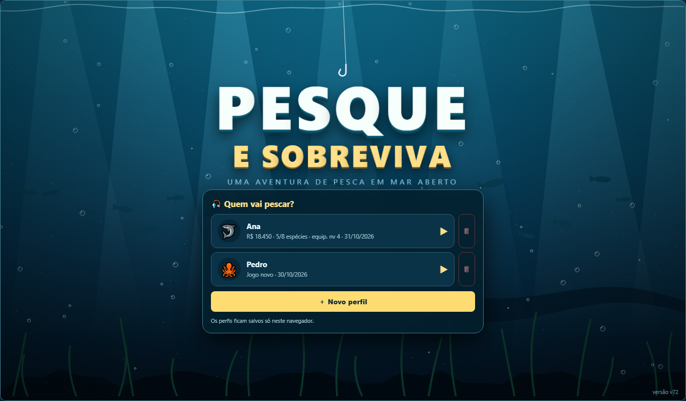
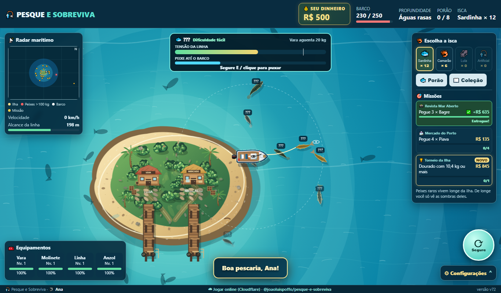

# 🎣 Pesque e Sobreviva

Jogo de pesca em mar aberto feito em **HTML, CSS e JavaScript puro**, num único arquivo e sem dependências. Pilote o barco, encontre os peixes, vença a briga na linha, venda no mercado, melhore seus equipamentos e não deixe o barco afundar.

**▶ Jogue agora:** https://pesque-e-sobreviva.serverfrontend.workers.dev/




## Como jogar

| Ação | Teclado / mouse | Celular |
|---|---|---|
| Pilotar o barco | Setas ou `W` `A` `S` `D` | Joystick na tela |
| Arremessar a isca | Clique no mar, dentro do círculo pontilhado | Toque no mar |
| Fisgar quando a boia afundar | `E`, `Espaço` ou clique | Botão 🎣 |
| Puxar o peixe na briga | Segure `E`, `Espaço` ou o clique | Segure o botão |
| Trocar a isca | `R` | Toque na isca |
| Menu | `Esc` | ⚙ Configurações |

**A briga:** segure para puxar e a tensão da linha sobe. Solte quando a barra ficar vermelha ou quando aparecer **"SOLTE! O peixe está puxando"**. Se a linha ficar frouxa por muito tempo, o peixe escapa.

Na primeira vez, um **guia interativo** explica tudo passo a passo.

## Destaques

- **Perfis**: vários jogadores no mesmo navegador, cada um com seu progresso. Dá para criar e excluir perfis.
- **8 espécies**, de piavas e tilápias perto da ilha a tubarões e enguias elétricas nas águas profundas, cada uma com isca preferida, zona e tamanho próprios.
- **Sea Beast**: uma serpente marinha rara que surge na zona abissal por poucos minutos. Só dá para encará-la com Vara, Molinete, Linha e Anzol no nível 10 ou mais.
- **Pedidos dos moradores da ilha**: missões variadas, como quantidade, peso mínimo, peixe pequeno, isca específica, combinações, espécies diferentes, zona, sequência sem perder peixe e quebra de recorde.
- **Equipamentos que importam**: a Vara aguenta mais peso, o Molinete puxa mais rápido, a Linha alcança mais longe e resiste mais, e o Anzol segura melhor.
- **Economia e sobrevivência**: iscas com estoque, porão limitado, desgaste das peças e reparos do casco. Ataques e batidas danificam o barco.
- **Visual e som**: peixes animados vistos de cima, ondas e espuma, esteira do barco, radar, abertura animada, ronco do motor de popa que acompanha a aceleração, ondas no casco e gaivotas.
- **Coleção** de espécies com recordes de peso.

O jogo é salvo automaticamente no navegador (`localStorage`). Nada é enviado para servidores.

## Estrutura do projeto

```
www/pesqueesobreviva.html   ← o jogo (versão atual, arquivo único)
www/versoes/                ← cópias de todas as versões anteriores
cloudflare/                 ← pasta publicada no Cloudflare (index.html = o jogo)
publicar-cloudflare.ps1     ← publica a versão atual no Cloudflare
src/ + build.ps1            ← servidor local opcional (serviço do Windows "Server Front End")
docs/                       ← imagens deste README
```

## Rodar localmente

- **Mais simples:** abra `www/pesqueesobreviva.html` no navegador.
- **Como servidor no Windows:** rode `instalar-servico.ps1` como administrador. Ele compila um pequeno servidor HTTP em C# (.NET Framework, já incluso no Windows) e o instala como serviço que inicia com o sistema. Depois acesse `http://localhost:8080/pesqueesobreviva.html`. Para remover, use `desinstalar-servico.ps1`.

## Publicar

O jogo está no Cloudflare (Workers com arquivos estáticos). Com o [Node.js](https://nodejs.org) instalado e `npx wrangler login` feito uma vez:

```powershell
powershell -ExecutionPolicy Bypass -File .\publicar-cloudflare.ps1
```

## Versões

A versão aparece no rodapé do jogo. Cada nova versão substitui `www/pesqueesobreviva.html`, e a anterior é guardada em `www/versoes/`.
